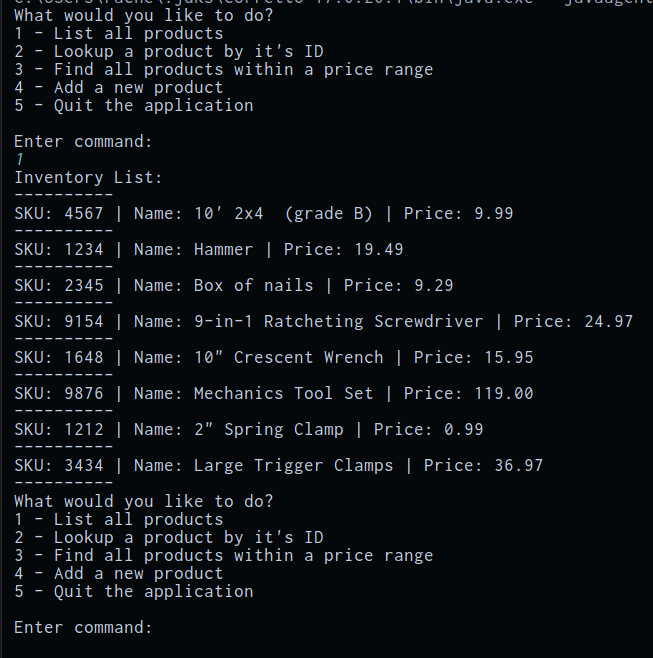

# Search Inventory

A command-line application that reads a hardware store inventory list from a file, stores the data as inventory item objects in an arraylist, then writes the list to a CSV file. Additional functionality allows the user to select an option from a menu to view the inventory, search for specific items, and filter the list.

## Features

- Prompt the user for the inventory list file name
- Prompt the user to select from a menu of options
- Automatically save the items from the list into an inventory arraylist
- Automatically write the inventory list to a CSV file

## How to run it

1. Open the project in IntelliJ
2. Run `App.java`
3. Type the name of the inventory list file (be sure this file is accessible)
4. Type the menu selection (1, 2, 3, 4, 5)
5. The program will automatically generate the new `item-list.csv` file.

## Interesting code
```java
private static ArrayList<Item> getInventory() {
        ArrayList<Item> inventory = new ArrayList<>();
        try {
            BufferedReader bufferedReader = new BufferedReader(new FileReader("inventory.csv"));
            BufferedWriter bufferedWriter = new BufferedWriter(new FileWriter("items-list.csv"));

            String line;
            while ((line = bufferedReader.readLine()) != null) {
                String[] fields = line.split("\\|");

                Item item = new Item(Integer.parseInt(fields[0]), fields[1], Double.parseDouble(fields[2]));
                inventory.add(item);

                bufferedWriter.write(item.getItemSku() + " | " + item.getItemName() + " | " + item.getItemPrice() + "\n");
            }

            bufferedReader.close();
            bufferedWriter.close();

        } catch (IOException e) {
            //throw new RuntimeException(e);
            System.out.println("Unable to read file. Please ensure file is in the correct location and try again.");
        }


        return inventory;
    }
```

## Screenshots



